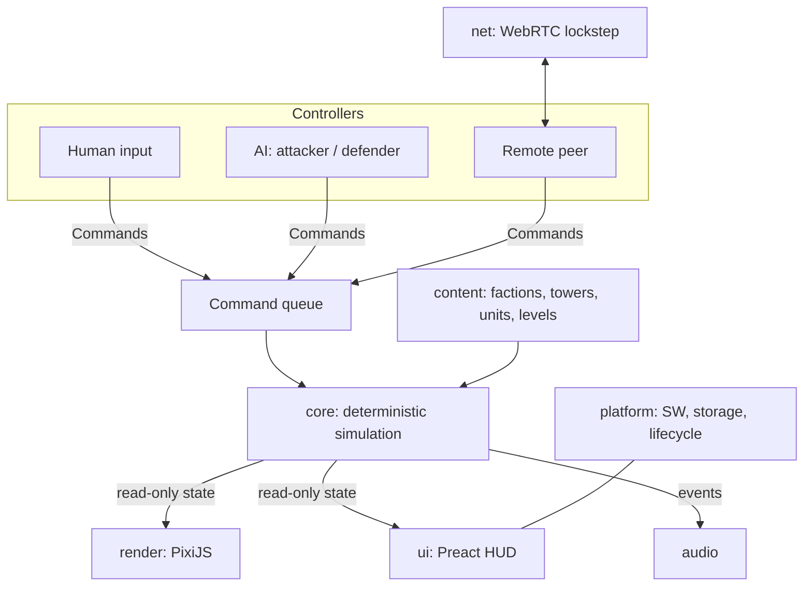

# Architecture

## Goals that shape the design

1. **Mobile-first PWA.** Installable, playable offline, portrait, touch, smooth on a
   mid-range phone.
2. **One simulation, many modes.** Defense, Attack, Two-way and P2P must all run on the
   same rules engine with only the *source of commands* changing.
3. **P2P without an authoritative server.** That requires the simulation to be
   deterministic from day one — retrofitting determinism later means rewriting the core.
4. **Reskinnable.** Lore, names, stats and art are data, not code.
5. **The server is an enhancement, never a requirement.** Every mode, including P2P,
   must be playable with no server running. A server adds assurance (verified results,
   easier matchmaking); its absence only removes that assurance and is shown as such.

## Tech stack

| Concern | Choice | Why |
| --- | --- | --- |
| Language | TypeScript (strict) | Shared types between sim, UI and net |
| Build | Vite | Fast dev loop, simple static output |
| PWA | `vite-plugin-pwa` (Workbox) | Precache app shell and assets, update flow |
| Rendering | PixiJS (WebGL, canvas fallback) | Sprite batching for hundreds of units on mobile |
| UI / menus / HUD | Preact + DOM overlay | Small bundle; text, buttons and accessibility are easier in DOM than canvas |
| Persistence | IndexedDB (via `idb`) | Saves, settings, progress, replays |
| Networking | WebRTC DataChannel | Direct P2P; no game server |
| Tests | Vitest (unit), Playwright (smoke) | Sim is pure TS and runs headless |
| CI / hosting | GitHub Actions → static host (GitHub Pages or Cloudflare Pages) | The whole game is static files |

## Layering



The hard rule: **`core` imports nothing from the browser** — no DOM, no `Date.now()`, no
`Math.random()`, no PixiJS. It is enforced twice: `tsconfig.core.json` typechecks `core`
and `content` without the DOM library, and ESLint bans the imports and the two calls. Everything else depends on `core`; `core` depends only on
`content` types.

## Repository layout

```
/
├─ docs/
├─ public/                 # manifest icons, static assets
├─ src/
│  ├─ core/                # deterministic simulation (pure TS)
│  │  ├─ state.ts          # GameState, entity tables
│  │  ├─ commands.ts       # Command union + validation
│  │  ├─ tick.ts           # step(state, commands) pipeline
│  │  ├─ grid.ts           # cells, occupancy
│  │  ├─ pathfinding.ts    # BFS distance field
│  │  ├─ systems/          # spawn, movement, targeting, combat, economy, waves
│  │  ├─ rng.ts            # seeded PRNG
│  │  ├─ fixed.ts          # fixed-point helpers
│  │  └─ hash.ts           # state checksum
│  ├─ content/             # data packs: factions, towers, units, levels
│  ├─ game/                # session (fixed-step loop, command log, save) and
│  │                       #   controller (input → commands, HUD publishing)
│  ├─ render/              # PixiJS scene, sprites, effects
│  ├─ ui/                  # Preact screens and HUD
│  ├─ platform/            # storage, audio
│  ├─ controllers/         # (planned) ai-defender, ai-attacker, remote
│  ├─ net/                 # (planned) signaling, transport, lockstep
│  └─ main.tsx
├─ server/                 # verification server (Node, no runtime deps) — see 06-server.md
└─ tests/                  # core, session and server tests + a reference bot
```

## The simulation (`core`)

### Fixed timestep

- The sim advances in fixed **ticks of 50 ms (20 Hz)**. Rendering runs at display rate
  and interpolates between the last two sim states.
- The game loop accumulates real time and runs zero or more ticks per frame, capped to
  avoid a spiral of death after the tab was backgrounded.
- Game speed (1×/2×, pause) changes ticks per real second, never the tick length.

### Determinism rules

Same initial state + same commands on the same ticks ⇒ bit-identical state on every
device. To guarantee it:

- **No floats in game state.** Positions, HP, timers use integers or fixed-point
  (sub-cell positions in 1/1024 of a cell). Floats are allowed only in `render`.
- **Seeded PRNG** stored in the state; nothing else may produce randomness.
- **Stable iteration order.** Entities live in arrays ordered by a monotonically
  increasing id; no iteration over `Map`/`Set`/object keys where order could differ.
- **No wall-clock time** inside `core`.
- A cheap **state hash** per tick, used by tests, replays and P2P desync detection.

### Commands

Every change to the game that originates outside the sim is a command stamped with a
tick and a player id:

```ts
type Command =
  | { type: 'placeStructure'; kind: StructureId; cell: CellIndex }
  | { type: 'sellStructure'; cell: CellIndex }
  | { type: 'upgradeTower'; cell: CellIndex }
  | { type: 'repairStructure'; cell: CellIndex }
  | { type: 'setTargeting'; cell: CellIndex; mode: TargetingMode }
  | { type: 'startWave' }
  // planned with Attack mode:
  | { type: 'spawnUnit'; kind: UnitId; column: number }
  | { type: 'useAbility'; ability: AbilityId; cell: CellIndex };
```

The sim validates each command against the current state (enough supplies, cell free,
path not sealed, player is allowed that command in this mode) and silently drops invalid
ones. Validation inside the sim — not in the UI — is what keeps peers in agreement.

A match is fully described by `{ contentVersion, levelId, faction, seed, commands[] }`.
That gives replays, bug reproduction, the save format (resume re-simulates the log) and
the basis for [result verification](05-anti-cheat.md).

### Tick pipeline

```
apply commands for this tick
→ waves / spawning
→ pathfinding (only if the grid changed)
→ movement
→ unit abilities (shoot / trample / breach / heal), structure destruction
→ targeting
→ combat (attacks, projectiles, status effects)
→ deaths, bounties, base damage
→ win / lose check
→ emit events (for audio + effects)
```

### State model

Plain data, no classes with behaviour, no heavyweight ECS library:

- `grid`: typed array of cell types + structure ids.
- `structures[]`, `units[]`, `projectiles[]`: arrays of plain records.
- `players[]`: role (defender/attacker/both), faction, supplies, base HP.
- `wave`, `tick`, `rng`, `outcome`.

Systems are pure functions over this state. It is serialisable as-is (save, replay
checkpoint, P2P resync).

### Pathfinding

- One **BFS from all base cells outward** over walkable cells produces a distance field
  (`Uint16Array`, one entry per cell). Cost: O(cells) = 135 cells on the default grid —
  negligible, so it is simply recomputed on every grid change.
- A ground unit steps to the orthogonal neighbour with the lowest distance. Ties are
  broken by a fixed direction order (down, left, right, up) so results are deterministic.
- **Seal check** for a proposed build: run the BFS on the hypothetical grid and reject if
  any spawn cell or any cell currently occupied by a ground unit is unreachable.
- Flying units skip the field and move straight toward the base row.
- Breaching units read a second field (Dijkstra, structures passable at a cost of six
  extra cells) and attack whatever structure their next step lands on. The seal check
  ignores a breacher's next cell when it is a structure, so building stays possible
  while one is chewing through a wall.
- In Two-way mode each board has its own field.

## Controllers

A controller is anything that produces commands for a player slot:

| Controller | Used in |
| --- | --- |
| `HumanController` | Every mode — turns UI intents into commands |
| Wave system (in `core`) | Defense — expands the level's authored waves into a spawn queue using the state RNG |
| `AttackerAI` | Two-way vs AI — budgeted, reactive spawning |
| `DefenderAI` | Attack and Two-way vs AI — builds from authored layouts plus heuristics |
| `RemoteController` | P2P — commands arriving from the peer |

Modes are just different controller assignments on the same sim. In the current build
scripted waves are a system inside `core` (they need the seeded RNG and no outside
input); a `spawnUnit` command for human, AI and remote attackers is added with Attack
mode and calls the same spawn function.

## Rendering

- PixiJS stage with layers: terrain → structures → units → projectiles → effects → build
  preview overlay.
- Renderer reads sim state and interpolates unit positions between ticks; it never
  writes to state.
- Sim **events** (unit died, tower fired, structure placed) drive particles and sound.
- Sprite atlases per faction, loaded on demand; object pools for units and projectiles.
- Canvas sized to `devicePixelRatio` (capped at 2) and re-laid-out on resize and
  orientation change. Portrait is the designed orientation; landscape letterboxes.

## Content packs

`content/` defines factions, structures, units, waves and levels as typed data:

```ts
interface TowerDef {
  id: StructureId; faction: FactionId; cost: number;
  range: number; cooldownTicks: number; damage: number;
  attack: 'single' | 'splash' | 'chain' | 'cone' | 'pulse';
  effects?: StatusEffectDef[]; upgrades: TowerUpgradeDef[];
  sprite: string; nameKey: string;
}
```

- Display names go through an i18n table (`nameKey`), art through atlas keys.
- The engine knows about *mechanics* (slow, knockback, flying, siege) but never about
  *lore*. Replacing the theme means replacing the content pack and atlases only.
- Content carries a `contentVersion`; saves, replays and P2P handshakes check it.

## PWA and platform

- **Manifest:** `display: standalone`, `orientation: portrait`, themed icons, maskable
  icon.
- **Service worker:** precache app shell and core assets; runtime-cache faction atlases;
  "new version available" prompt rather than silent reload mid-game.
- **Offline:** all single-player modes work with no network.
- **Lifecycle:** auto-pause on `visibilitychange`; autosave at wave boundaries; Screen
  Wake Lock while a wave is running.
- **Layout:** `viewport-fit=cover` with safe-area insets; touch targets ≥ 44 px;
  `touch-action: none` on the canvas to stop scroll and zoom gestures.
- **Storage:** IndexedDB for progress, settings, in-progress match, replays. Request
  persistent storage after the first level is completed.
- **Audio:** WebAudio, unlocked on first tap, respects a mute setting.

## Networking (summary)

Deterministic **lockstep** over a WebRTC DataChannel: peers exchange only commands,
scheduled a few ticks in the future, and compare state hashes periodically. Details,
signaling options and failure handling are in
[Game modes — P2P](03-game-modes.md#p2p-multiplayer).

## Testing

- **Unit tests** for each system in `core`.
- **Determinism test:** run a recorded command log twice (and under shuffled insertion of
  irrelevant work) and assert identical per-tick hashes. Runs in CI on every push.
- **Golden replays:** a few recorded matches whose final hash must not change unless
  `contentVersion` or a sim version is bumped deliberately.
- **Pathfinding property tests:** random grids; the seal check never allows an
  unreachable spawn; unit routes are never longer than BFS distance.
- **Playwright smoke test:** boot the PWA at a phone viewport, place a tower, run a wave.
  Done by hand so far; not yet a committed test or a CI step.

## Performance budget

- Target 60 fps render on a mid-range phone with 150 units and 40 towers on screen.
- Sim tick under 2 ms at that load.
- Initial download (shell + one faction) under 1.5 MB compressed.
- No per-frame allocations in the render loop or the tick pipeline.
