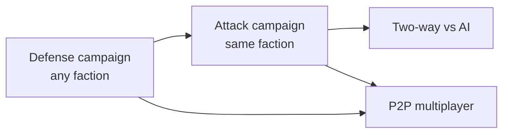

# Game modes

Four modes, unlocked in order. All of them run on the same simulation; what changes is
who issues which commands (see [Architecture — Controllers](02-architecture.md#controllers)).

| Mode | Player controls | Opponent | Status |
| --- | --- | --- | --- |
| Defense | Walls and towers | Scripted waves | Planned for MVP |
| Attack | Unit spawning | AI defender | Idea — outlined below |
| Two-way | Both, on two boards | AI doing both | Idea — outlined below |
| P2P multiplayer | Depends on format | Another human | Idea — outlined below |

## Unlock chain

- Finishing a faction's **Defense** campaign unlocks that faction's **Attack** campaign.
- Finishing **both** sides with at least one faction unlocks **P2P** and **Two-way**.
- In P2P a player may only field factions they have completed on the relevant side
  (to be decided: or any faction once P2P is unlocked — simpler, more generous).

The point of the gate is that nobody enters multiplayer without having learned both
halves of the game. Progress is stored on the device, so today the gate can be edited
past; once results are verified server-side it becomes a signed unlock. See
[Anti-cheat](05-anti-cheat.md).

---

## Defense (base mode)

Specified in [Game design](01-game-design.md). Top = enemy spawn, bottom = your base.

---

## Attack mode (reversed)

The player commands the attackers; an AI holds the base.

### Orientation

Keep the player's thumb where the action starts: the board is **flipped** so the player's
spawn row is at the **bottom** and the enemy base at the top. Internally it is the same
grid with the camera rotated 180°.

### Loop

1. **Scout.** The level opens showing the defender's layout — fully, or partly hidden by
   fog that lifts as units walk past.
2. **Compose and send.** The player chooses *which unit*, *which spawn column*, and
   *when*. Units then path on their own; the player does not steer them.
3. **Adapt.** The defender AI spends its own income on new towers and repairs between
   pushes, so one repeated tactic stops working.
4. **Win** by reducing the base to zero HP before the budget or the clock runs out.

### Resource ideas (pick one for the prototype)

- **Regenerating energy** (recommended first try): a bar that refills over time; every
  unit has an energy cost. Simple, tactile, encourages timing pushes.
- **Fixed army budget:** a set number of points for the whole level; puzzle-like,
  rewards efficiency, good for star ratings ("win using ≤ N points").
- **Deck / hand:** bring a loadout of unit cards and draw into a hand; adds
  pre-match decisions but also UI and balance cost.

### What makes attacking interesting

Just "spawn stuff" is shallow. Depth comes from:

- **Column choice matters** — the path from column 2 may pass different towers than the
  path from column 7.
- **Composition and ordering** — tanks first to absorb fire, healers behind, runners once
  the slow tower is busy.
- **Siege units** that break walls to open a shorter route, and **ranged units** that
  disable towers. This needs destructible structures (Phase 2 of the design).
- **Flying units** that bypass the maze but die to anti-air.
- **Abilities** on cooldown: one faction-flavoured active (e.g. a brief speed burst, a
  shield, a smoke screen over a tower).

### Defender AI

- Starts from a **level-authored layout** (hand-designed mazes are better puzzles than
  generated ones).
- Has a build budget and a small rule set: repair what is damaged, add towers that
  counter the unit types seen most, extend the maze where leaks happened.
- Difficulty = budget rate + how quickly it reacts, not hidden stat cheating.

### Engineering cost

Low on the sim side: `spawnUnit` is already a command. New work is the attacker HUD,
flipped camera, fog (optional), the defender AI, and attack-specific level content.

---

## Two-way mode (attack and defence)

Both players defend their own base *and* send units at the other.

### Layout: two mirrored boards (recommended)

Each player has their own 9×15 board. You build on yours; the units you send appear at
the top of your opponent's board, and theirs at the top of yours.

- Your screen shows **your board** full-size — where precise tapping is needed.
- The opponent's board is a **minimap** in the HUD; tap or swipe to peek full-size
  (read-only) to scout their maze.
- Both boards run inside **one simulation**, so it is one state and one hash.

The alternative — a single tall board with a base at each end — makes one continuous
battlefield but needs ~30 rows, so it cannot fit a phone screen without constant panning,
and shared build space raises griefing questions (walling the enemy in). Not recommended
for mobile.

### The central tension: one wallet

Offence and defence draw on the same supplies, so every purchase is a choice.

- **Income mechanic:** sending units permanently raises your per-interval income (the
  classic "income TD" model). Pure turtling falls behind economically; pure aggression
  leaks. This single rule creates the strategy.
- **Kill bounty** for defending well keeps defence from being purely a cost.
- **Wave rhythm:** sends are queued and released together on a shared timer (e.g. every
  20 s). It keeps the match readable on a small screen and softens latency in P2P.
- **Anti-stalemate:** after N minutes, both sides receive escalating neutral waves, or
  base HP drains, until someone falls.

### vs AI

Combines the `DefenderAI` and `AttackerAI` with a simple budget-split policy (e.g.
defend until leaks stop, then spend surplus on income units). Serves as practice and as
the offline version of the mode.

---

## P2P multiplayer

Unlocked after completing single-player on both sides. Direct browser-to-browser; no game
server and no accounts.

### Formats

1. **Asymmetric duel:** one attacks, one defends on a single board; then swap sides on
   the same level and seed. Winner is whoever dealt more base damage (or won faster).
   Cheapest to build because it needs nothing beyond Defense + Attack.
2. **Two-way duel:** the Two-way mode with a human on each board. The headline mode.

Ship format 1 first: it proves the networking with the least new game design.

### Netcode: deterministic lockstep

- Peers exchange **commands only**, never state. Bandwidth is a few bytes per second.
- Each local command is scheduled for `currentTick + inputDelay` (start with 3 ticks =
  150 ms) and sent immediately. A tick executes only once both peers have confirmed
  their commands for it (an empty confirmation counts).
- If a confirmation is late, the sim **stalls** briefly rather than guessing. For a
  tower defense — no twitch aiming — a small input delay is barely noticeable, so
  rollback netcode is not needed.
- Every N ticks peers exchange the **state hash**. On mismatch (desync): pause, the host
  sends a full state snapshot, the guest loads it and play resumes. Log the divergence
  for debugging — a desync is always a determinism bug.
- **Handshake** checks app build, `contentVersion`, level and seed before starting.

This is why the determinism rules in the architecture doc are non-negotiable.

### Connecting two phones

WebRTC needs a way to exchange the initial offer/answer (signaling). Options, in order of
effort:

| Option | How it works | Trade-off |
| --- | --- | --- |
| **QR / link exchange** | Host shows a QR code containing the offer; guest scans it and shows an answer QR back (or sends a link via messenger) | Zero servers; two-step handshake is clunky; great for playing in the same room |
| **Tiny signaling relay** | Host gets a short room code; a stateless edge function relays the offer/answer once | A few dozen lines of serverless code; much smoother; still no game traffic on the server |
| **Matchmaking** | A lobby service pairs strangers | Needs real backend, moderation, accounts — out of scope for now |

Plan: **QR / link exchange is the baseline and must always work**, because P2P has to be
playable with no server at all. The room-code relay is a convenience layered on top and
is used only when it is reachable.

### Playing without a server

P2P never depends on the verification server:

- **Connecting:** QR / link exchange needs nothing but the two devices.
- **Fair play:** lockstep and the periodic hash comparison run between the peers
  themselves, so a tampered client is still detected as a desync.
- **Results:** with no server, a match result is agreed by both peers' matching final
  hashes and recorded locally as *unverified*. Nothing is uploaded later on trust.
- **Unlock gate:** offline, the P2P unlock falls back to local campaign progress.

What the server adds when present: results that count for anything shared (rankings,
verified unlocks), arbitration when the two peers disagree, and disconnect tracking.
The interface shows which kind of match is being played.

NAT traversal: public STUN is enough for most home/mobile networks. Some carrier and
corporate NATs need a TURN relay, which costs money to run; treat it as optional and show
a clear "could not connect directly" message when it would have been needed.

### Failure handling

- **Backgrounded tab / lost signal:** the other peer sees a stall; show a countdown
  (e.g. 30 s) to reconnect, then award the win.
- **Reconnect:** rejoin by the same room code and resync from a host snapshot.
- **Cheating:** lockstep makes stat-hacking pointless — a modified client simply
  desyncs. It does not hide information: both clients hold the full state, so fog of
  war cannot be enforced between peers. Design P2P formats around open information.
  Disputed results, stalling and bots are covered in [Anti-cheat](05-anti-cheat.md).
- **Fairness:** both peers must run the same build; the service worker update prompt
  runs before matchmaking, not during.

### Later ideas

- Replays shareable as a link (seed + command log is tiny).
- Rematch with swapped factions.
- Spectator as a third lockstep peer that sends no commands.
- Asynchronous challenges: share a defended layout as a link; a friend attacks it
  offline and sends back the replay.
